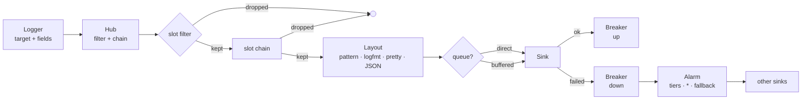
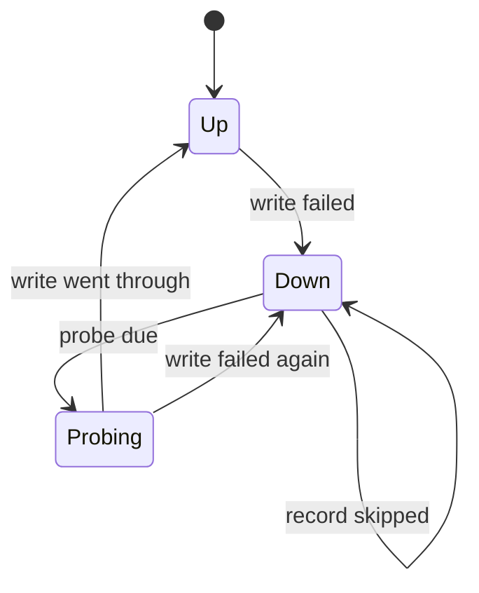

<div align="center">

# moonlog

**Structured logging for MoonBit.**<br/>
Six levels, typed fields, filters by target and level, chains of steps,
four layouts including ten JSON schemas, sinks behind a health machine, and
alarms that walk their tiers — with subpackages for the console, the file, Loki,
mail, a deployment document and the process-wide hub.

<sub><a href="#quick-start">Quick start</a> · <a href="#the-surface">The surface</a> · <a href="#layouts">Layouts</a> · <a href="#sinks-slots-and-what-happens-when-one-fails">Slots</a> · <a href="#out-to-the-world">Subpackages</a> · <a href="https://moonbitstack.github.io/moonlog/">Documentation</a></sub>

</div>

---

## Quick start

```moonbit
let sink = @moonlog.Lines::new(fn(line) { println(line) })
let hub = @moonlog.Hub::new(clock=fn() { 1_700_000_000_000_000_000L })
let _ = hub.add(
  @moonlog.Slot::new(sink, name="console")
  .layout(@moonlog.Pattern::parse("{time:%H:%M:%S%.3f} {level:<5} {target}: {msg}{fields}")),
)

let log = hub.logger("mirror::sync")
log.info("starting", fields=[("workers", @moonlog.Value::of_int(4))])
log.warn("slow", fields=[("took_ms", @moonlog.Value::of_int(1200))])
// 22:13:20.000 INFO  mirror::sync: starting workers=4
// 22:13:20.000 WARN  mirror::sync: slow took_ms=1200
```

```bash
moon add moonbitstack/moonlog
```

## What it does not do

**It does not read a clock.** Every instant arrives as nanoseconds since the
epoch, from the `clock` a hub was built with. A logger that reads the time
writes something different every run; here the instant is always one the
application named, and a minute of sampling replays in a loop without waiting
for the minute.

**It does not keep a global logger.** A hub is a value and a logger is a value.
A library takes a `Logger` as a parameter and writes through it; a library that
was handed none writes nothing. Nothing in this package can be configured
behind your back. An application that wants one place to configure has
`moonlog/global`, which is a subpackage precisely so that this one can stay a
value.

**It does not format messages.** A message is a `String`, built at the call
site with interpolation. A format language needs an escape for itself, a rule
for a missing argument, and a way to be wrong at run time about both.

**It does not write anywhere by itself.** A sink is one method — hand it an
entry and say what went wrong. `Lines::new(fn(line) { println(line) })` prints,
`Memory::new()` keeps what a test wants to read, and a sink of your own reaches
whatever you were going to write to anyway.

## How a record travels



A record is built with the hub's instant and sequence number, filtered once for
everyone, run through the hub's chain, then offered to each slot in turn: its
own filter, its own chain, its own layout, its own sink. A failure drives that
slot's breaker, and the breaker decides whether an alarm is owed.

## The surface

### Levels

| Level | Value | Colour | Written as |
|:--|:--:|:--:|:--|
| `trace` | 10 | cyan | `TRACE` |
| `debug` | 20 | magenta | `DEBUG` |
| `info` | 30 | green | `INFO` |
| `warn` | 40 | yellow | `WARN` |
| `error` | 50 | red | `ERROR` |
| `fatal` | 60 | white on red | `FATAL` |

A level is a value, not an enumeration, so `{ name: "notice", value: 35, colour: Blue }`
works in filters, calls and layouts alike. Only `value` counts when comparing.
`Level::parse` takes any capitalisation, `warning`, `critical`, and 0 to 255.
`Level::label(profile)` writes it the way a profile's logger would — `WARNING`
for Python, `ERROR+4` for `slog`.

### Values and records

| Type | What it carries |
|:--|:--|
| `Value` | `Null`, `Bool`, `Int`, `Float`, `Str`, `List`, `Map`, `Error(message, causes)`, `Other(text)` |
| `Caller` | module path, function, file, line — every part optional |
| `Record` | level, target, message, ordered fields, tags, caller, thread, span chain, instant, sequence number |
| `Identity` | app, env, instance, host, pid, start, and the offset local time is written with |

Fields are `(String, Value)`, in the order they were given; a later field of the
same name replaces the earlier one where it stands. `Record::set`, `::unset`,
`::say`, `::at`, `::tag`, `::stamped`, `::located` and `::on` each answer a copy,
so a step that changes a record cannot be seen by the slot next door.

### Filters

Comma-separated directives:

| Directive | Meaning |
|:--|:--|
| `info` | the default level |
| `app=debug` | target `app` and everything under it |
| `app` | everything for `app` |
| `app=off` | nothing for `app` |
| `web:*=error` | `*` matches any run of characters |
| `info/sync(ed)?` | the message must also match the expression after `/` |
| `35` | a level by number |

A target matches itself and everything under it, split at `::`, `.`, `:` or `/`,
and the most specific directive wins: literal targets by length, then wildcards.
Targets no directive matches are off unless a default level was given, and an
empty spec lets `error` and above through.

### Steps

A `Processor` may change a record or drop it. The hub's chain runs first, then
each slot's own.

| Step | Options | Effect |
|:--|:--|:--|
| `Redact` | `key`, `path`, `pattern`, `mask` | masks fields by name at any depth, at a dotted path, and matches in the message |
| `Sanitise` | — | escapes line breaks, tabs and control characters as `\n`, `\r`, `\t`, `\u{0007}` |
| `Fields` | key-value pairs | sets fields on every record |
| `Keep` | `tag`, `field`, `level` | keeps a record only when every condition holds |
| `Exclude` | the same | drops a record when every condition holds |
| `Sample` | `first`, `every`, `per` | per level and message, keeps the first `first` in each `per`, then one in `every` |
| `Limit` | `rate`, `burst` | a token bucket of `rate` a second holding up to `burst` |
| `Dedupe` | `within` | drops repeats within the window; the next one kept carries `repeated` |

The steps that need a moment are handed one: `Processor::process(record, Env)`,
where `Env::at(nanoseconds)` is the hub's instant. Nothing here reads a clock.

### Layouts

A `Layout` turns a record into one line. `Scene` says how: which profile's
vocabulary, whether a terminal takes colour, and which identity is writing.

| Layout | Output |
|:--|:--|
| `Pattern` | a template, or a preset name |
| `Logfmt` | `time=… level=warn target=app msg="…" key=value` |
| `Pretty` | a first line, then one aligned `key = value` per field |
| `JsonLine` | one object in a schema, with keys renamed, levels by name or number, fields nested |

| Preset | Reproduces | Pattern |
|:--|:--|:--|
| `serlog` | the default | `{time} {level:<5} {target}: {msg}{fields}` |
| `tracing` | `tracing-subscriber` | `{time:rfc3339} {level:>5} {spans}{target}: {msg}{fields}` |
| `env_logger` | `env_logger` | `[{time:utc} {level:<5} {target}] {msg}` |
| `python` | `logging.basicConfig` | `{level}:{target}:{msg}` |
| `logback` | Logback, Log4j 2 | `{time:%H:%M:%S%.3f} [{thread}] {level:<5} {target:~36} - {msg}` |
| `slog` | Go's `slog.TextHandler` | `time={time:%Y-%m-%dT%H:%M:%S%.3f%:z} level={level} msg={msg:q}{fields:q}` |
| `pino` | `pino-pretty` | `[{time:%H:%M:%S%.3f}] {level} ({pid}): {msg}{fields}` |

Every token but `time` may end with `<N`, `>N` or `^N` to pad to N columns, then
`.M` to keep at most M characters:

| Token | Options | Writes |
|:--|:--|:--|
| `time` | `local`, `utc`, `rfc3339`, `unix`, `unix_ms`, `unix_ns`, or strftime | the instant |
| `level` | `lower` | the level, as the profile or the preset spells it |
| `target` | `~N` shortens leading segments until it fits | where the record came from |
| `module`, `func`, `file`, `line` | `file:base` keeps the name | the caller, `?` when unknown |
| `thread`, `tid`, `task` | | where it ran |
| `pid`, `host`, `app`, `env`, `instance` | | the identity |
| `msg`, `fields` | `q` quotes the logfmt way | the message, and ` key=value` per field |
| `tags`, `error`, `spans` | | tags, the error field with its causes, the span chain |
| `elapsed`, `seq` | | milliseconds since the identity's start, the record's number |

| Schema | Keys |
|:--|:--|
| `serlog` | `time` `level` `target` `msg` `file` `line` fields `app` `env` `instance` |
| `pino` | `level` `time` `pid` `hostname` fields `msg` |
| `bunyan` | `name` `hostname` `pid` `level` fields `msg` `time` `v` |
| `zap` | `level` `ts` `logger` `caller` `msg` fields |
| `slog` | `time` `level` `msg` fields |
| `structlog` | `event` fields `level` `logger` `timestamp` |
| `logstash` | `@timestamp` `@version` `message` `logger_name` `thread_name` `level` `level_value` fields |
| `ecs` | `@timestamp` `log.level` `message` `ecs.version` `log.logger` `log.origin.*` `process.pid` `host.hostname` `service.*` fields |
| `gelf` | `version` `host` `short_message` `timestamp` `level` `_target` fields, each prefixed `_` |
| `otel` | `timestamp` `severity_text` `severity_number` `body` `attributes` `resource` |

### Sinks, slots, and what happens when one fails

A `Sink` is one method: `write(entry)`. An entry is the record and the line the
slot's layout made of it. `Lines`, `Memory` and `Discard` come with the package;
a sink of your own is a struct and three lines.

A `Slot` is where everything else lives:

| Setting | Default | What it does |
|:--|:--|:--|
| `name` | — | how an alarm names it; `*` is refused |
| `kind` | `custom` | what the sink is, for a status page |
| `filter` / `at` | the hub's filter alone | what reaches this sink |
| `process` | none | steps that run for this slot only |
| `layout` | the profile's pattern | how entries are written |
| `coloured` | false | whether the line carries escapes |
| `queue` | direct | `size`, `batch`, `wait`, `full`: `Drop` or `Block` |
| `retries` | 0 | how many more times a failed write is tried |
| `probe` | 5 s | first wait before probing a failed sink, doubling to 5 min |
| `on_fail` | `Ignore` | `Panic`, `Ignore`, or `Alarm(tiers)` |
| `alarm_only` | false | keep it off the log route |

A slot's health is a machine with three states, and every transition is one
write:



`Up` writes. `Down` skips records until its next probe, counting them. `Probing`
is one write deciding. A first failure opens an incident; a failure during a
probe doubles the wait, up to five minutes, and reminds once the alarm's
interval has passed; a success resolves it, and the wait starts over.

`hub.status()` reports one `Status` per slot: its `name` and `kind`, its
`health`, the records it `skipped` while down, the records its queue `dropped`,
the records it `suppressed` because its own sink wrote them, when the current
health began, and the latest `error` while it is not up.

### Alarms

An `Alarm` says which sinks to try, in which tiers. `*` stands for every sink on
the log route. The walk leaves out the failing sink, leaves out any that are
resting, never asks the same sink twice, and stops at the first tier where one
sink took the record.

```moonbit
let oncall = @moonlog.Tiers::from([["loki"], ["mail"], ["stderr"]])
  .with_fallback(@moonlog.Fallback::Ignore)
  .with_remind(1_800_000_000_000L) // half an hour

let _ = hub.add(
  @moonlog.Slot::new(sink, name="loki").on_fail(@moonlog.OnFail::Alarm(oncall)),
)
```

An incident becomes a record: `error` when a sink failed, `info` when it works
again, with `sink`, `kind`, `phase`, `failures`, `skipped`, `dropped` and `since`
on it. Alarm records skip slot filters, because they are not a message from your
program.

### Profiles

A profile changes four things at once, because those are the four a deployment
already expects:

| Profile | Console | Level | Filter variable |
|:--|:--:|:--:|:--|
| `serlog` | stdout | info | `SERLOG_FILTER` |
| `tracing` | stdout | info | `RUST_LOG` |
| `env_logger` | stderr | error | `RUST_LOG` |
| `python` | stderr | warn | — |
| `logback` | stdout | debug | — |
| `slog` | stdout | info | — |
| `pino` | stdout | info | — |

## Out to the world

The root package formats records and hands them to a sink; nothing in it
touches a console, a disk or a socket. Those parts are subpackages, each one
usable on its own:

| Package | What it adds | Targets |
|:--|:--|:--|
| `moonlog/stdio` | a console on stdout, stderr, or both — `Console` | native, wasm, wasm-gc, js |
| `moonlog/file` | a file that rotates itself — `File`, `Rotation`, `Limits` | native for the writing, all to compile |
| `moonlog/loki` | entries pushed to Loki — `Loki` | native, wasm |
| `moonlog/mail` | records mailed as one letter — `Mail` | native, wasm |
| `moonlog/config` | a deployment document read, checked and written back — `Config` | native for the file, all to parse |
| `moonlog/global` | the process-wide hub, for applications — `start`, `logger` | native |

```moonbit
let console = @stdio.Console::new()
let _ = hub.add(console.slot())

let file = @file.File::new(
  path="/var/log/gateway/app.log",
  mkdir=true,
  rotation=@file.Rotation::new(size=64_000_000L),
  limits=@file.Limits::new(keep=7),
  compress=true,
)
let _ = hub.add(file.slot())
```

A console decides once whether its lines carry escapes: `FORCE_COLOR`, then
`NO_COLOR`, then whether the stream is a terminal, and `Console::slot` hands
that answer to the slot. A file opens on its first line, so a path it cannot
open is a failing slot the health machine handles rather than a failure at
startup; segments are named after the instant they were cut, in UTC, and are
pruned by count, age or total size.

The two network sinks queue instead of writing: a log call never waits for a
socket. `Loki::push` and `Mail::send` do the talking, from an async loop the
application already runs, and a batch that has to be tried again goes back at
the front of the queue in order.

```moonbit
let loki = @loki.Loki::new(url="http://loki:3100", labels=[("job", "gateway")])
let _ = hub.add(loki.slot())
// in a loop you already have:
match loki.push() {
  report if report.pushed() => ()
  _ => ()  // the report says why, and what is still queued
}
```

A deployment file is where all of that is usually configured. `Config` reads
YAML, JSON or TOML into one tree, checks every key against what its kind of
sink reads, refuses a typo with the path it sits at, and can write itself back
out in another format.

```yaml
profile: serlog
filter: info, gateway=debug
slots:
  console:
    kind: stdio
    stream: auto
  app:
    kind: file
    path: /var/log/gateway/app.log
    max_size: 64mb
    every: 24h
    keep: 7
```

```moonbit
@global.start(config=@config.Config::load(path="/etc/gateway.yaml"))
@global.logger("gateway").info("serving", fields=[("port", @moonlog.Value::of_int(8080))])
@global.flush()
```

`moonlog/global` is the one place a process-wide hub lives, and only an
application imports it: a library still takes a `Logger` and writes through it.
With no document it sets up a console at the profile's own stream and level,
reading `SERLOG_COMPAT`, `SERLOG_FILTER` and `SERLOG_FORMAT` — so a program
that configures nothing still logs, and a program that configures everything
says so in one file.

## Examples

| Example | What it shows |
|:--|:--|
| `01-tour` | a hub, two slots, a filter, a logger with a bound field, and one record in six shapes |
| `02-formats` | every preset, every schema, renamed keys, a coloured line |
| `03-service` | a service: redaction, sampling, a queue, a sink that is down, an alarm that falls back |
| `04-console` | three consoles, the colour decision, and a coloured line |
| `05-file` | a file cutting itself into compressed segments, and the segments it kept |
| `06-config` | a document read, checked, dumped as another format, and read back |
| `07-shipping` | the push body and the letter the two network sinks would send |
| `08-world` | a process hub started from a document, a logger, one flush |

```bash
moon run src/examples/01-tour
```

## Licence

Apache-2.0. See [LICENSE](LICENSE).
